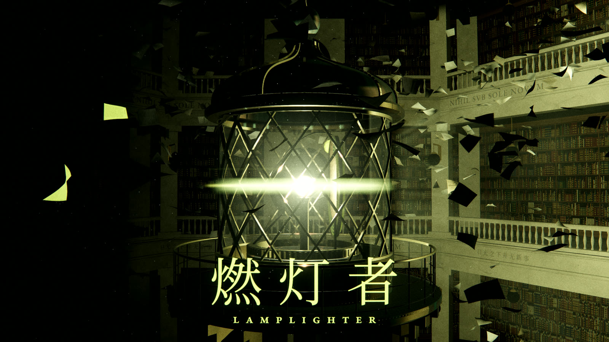

# 燃灯者 LAMPLIGHTER

[AIGC Radar](https://aigcnews.cn) 的宣传片。3 分 59 秒，4K，24 帧，中英两版。

**0 张 AI 生图。** 片中每一帧画面、每一个音符，都由这个仓库里的代码生成。代码由 AI 编写，有 4 万多行：

- 45 个镜头，每个镜头是一个 Three.js 场景模块；
- 配乐是管风琴加合成器，由乐谱代码合成，没有采样，仓库里也没有一个音频文件；
- 字体都是开源字体（SIL OFL）。

片中的网站界面是 aigcnews.cn 公开页面的实拍截图，放在 `assets/ui/`。只拍游客能看到的页面，第三方的头像和图片都打了码。片中的项目、星数和今日增长，都是网站 2026 年 10 月 8 日的真实数据。除此之外没有任何外部素材。

**观看**：B 站、抖音、YouTube 即将上线，链接到时补在这里。

[English](#english)

## 在自己的电脑上渲一遍

需要 Windows 10/11 和 NVIDIA 显卡，只用一个文件：`render-windows.cmd`。它会装好依赖、下载片子，先确认你的显卡渲出的画面和参考帧一致，再渲出中英两版。

1. 准备
   - 插上电源，不要合上屏幕。
   - 找一块剩余空间不少于 80 GB 的盘。
2. 打开本仓库里的 `render-windows.cmd`，点右上角的「Download raw file」下载，放进那块盘上的一个空文件夹，例如 `D:\render\`。
3. 双击 `render-windows.cmd`。
   - 如果出现「Windows 已保护你的电脑」，点「更多信息」，再点「仍要运行」。
   - 缺 Git、Node.js 或 FFmpeg 时，会用 winget 自动安装，安装时会弹出管理员确认，点「是」。装完如果提示关掉窗口重开，就关掉再双击一次。
   - 片子会下载到旁边的 `lamplighter` 文件夹，不需要 GitHub 账号。
4. 之后全自动：检查、渲画面、合成声音、出母版。全部完成后会自动打开 `lamplighter\renders\master`。
   - 中途可以随时关掉窗口，再双击就从断点继续。
   - 以后再双击，会先拉取最新版本。

**要多久**：在一台 RTX 3060 笔记本上实测，全程约 4 小时。

| 步骤 | 实测 |
|---|---|
| 1–3：装工具、选显卡后端、逐帧比对参考帧 | 约 8 分钟，含下载约 200 MB 的 Chromium |
| 4：渲 4K 画面，共 6840 帧（中文全片 5736 帧，加上英文版里带文字的 1104 帧） | 38 分钟 |
| 5：合成声音 | 几分钟 |
| 6：出两版母版和发布版，用 CPU 编码 | 约 3 小时 15 分，大头是 HEVC，每版约 75 分钟 |

占用空间：镜头文件二十多 GB；每版 ProRes 母版约 17.6 GB，每版的三个发布版合计约 3.8 GB。

出了问题，窗口里会用中文说明原因和该怎么做，完整记录在 `lamplighter\renders\windows.log`。

几个注意事项：

- 渲染时别在黑色窗口里点鼠标。Windows 会因此暂停输出，渲染也跟着停住。不小心点了，按一下 Esc 就能继续。
- 网络：要能访问 GitHub、npm 和 Playwright 的下载地址，连不上就先打开代理。npm 包和 Chromium 在官方地址连不上时，会自动改从国内镜像 npmmirror 再试一次。
- 只想做检查、不渲染：在命令行里运行 `render-windows.cmd --test`。
- 显卡后端选定以后想重新选：运行 `render-windows.cmd --recheck`。

## 产出

在 `renders\master\zh\` 和 `renders\master\en\` 里：

| 文件 | 内容 |
|---|---|
| `LAMPLIGHTER_<语言>_4K_ProRes422HQ.mov` | 母版：4K ProRes 422 HQ，配 24-bit PCM 影院混音（−24 LUFS） |
| `LAMPLIGHTER_<语言>_4K_HEVC10.mp4` | 4K HEVC 10-bit 发布版，配网络混音（−14 LUFS） |
| `LAMPLIGHTER_<语言>_4K_H264.mp4` | 4K H.264 发布版，配网络混音 |
| `LAMPLIGHTER_<语言>_1080p_H264.mp4` | 1080p H.264，便于分享 |

传视频网站用 H.264 或 HEVC 发布版。ProRes 母版配的是影院混音，放到网上会偏小声。磁盘不够时会跳过 ProRes 母版，只出发布版。声音的混音和分轨在 `audio\out\`。

## 仓库里有什么

| 路径 | 内容 |
|---|---|
| `film/timeline.json` | 时间线：45 个镜头、帧数、字幕卡、分幕调色 |
| `shots/` | 每个镜头一个模块；`_` 开头的是调试用的场景 |
| `engine/runtime/` | 在浏览器里逐帧渲染的运行时 |
| `engine/world/` | 片中的世界：书库、灯塔、书页、读者、星球等 |
| `engine/tools/` | 渲染队列、参考帧比对、光敏检查、母版、Windows 一键流程 |
| `audio/synth/` | 乐谱和合成器，说明见 `audio/README.md` |
| `assets/ui/` | 网站页面的实拍截图 |
| `engine/fonts/` | 字体，以及每套字体的 OFL 许可证 |

代码注释里提到的 BIBLE 和 screenplay，是制作期间的剧本和技术约定，没有放进这个仓库。

## 版权

本仓库没有附开源许可证，代码和影片保留所有权利。第三方部分沿用各自的许可证：three.js 是 MIT（`engine/vendor/three/LICENSE`），字体是 SIL OFL 1.1（`engine/fonts/OFL-*.txt`）。

---

## English

**LAMPLIGHTER** is a brand film for [AIGC Radar](https://aigcnews.cn): 3:59, 4K, 24 fps, in Chinese and English versions.

**Zero AI-generated images.** Every frame and every note of the film is generated by the code in this repository: 40,000+ lines, written by AI.

- 45 shots, each one a Three.js scene module.
- The score, pipe organ and synthesizers, is synthesized from code. There are no samples, and no audio files in the repository.
- The fonts are open-source (SIL OFL).

The website shots are real screenshots of aigcnews.cn's public pages, in `assets/ui/`. They show only what a guest can see, with third-party avatars and images blurred. The projects, stars and daily growth on screen are the site's real data from October 8, 2026. There is no other outside material.

**Watch**: coming soon on Bilibili, Douyin and YouTube; the links will go here.

### Render it yourself

You need Windows 10/11, an NVIDIA GPU and a drive with at least 80 GB free.

1. Open `render-windows.cmd` in this repository, choose "Download raw file", and save it into an empty folder on that drive.
2. Double-click it. It installs Git, Node.js and FFmpeg with winget if they are missing, and downloads the film into a `lamplighter` folder next to it (no GitHub account needed). It checks frame by frame that your GPU's picture matches the reference frames, then renders both versions and makes the masters.
3. When it is done, `lamplighter\renders\master` opens.

The window speaks Chinese; the full log is `lamplighter\renders\windows.log`. You can close the window at any time and double-click again to resume. Don't click inside the console window while it renders: Windows pauses the output, and the render stops with it. Press Esc to go on.

On an RTX 3060 laptop the whole run took about 4 hours:

- the checks: about 8 minutes, including the Chromium download;
- the 4K picture, 6840 frames: 38 minutes;
- the sound: a few minutes;
- the masters, encoded on the CPU: about 3 hours 15 minutes.

The outputs are in `renders\master\zh\` and `renders\master\en\`:

- a 4K ProRes 422 HQ master with the cinema mix (−24 LUFS);
- 4K HEVC 10-bit and 4K H.264 releases with the web mix (−14 LUFS);
- a 1080p H.264 copy with the web mix.

For video sites, upload a release file, not the master: the cinema mix plays quiet online.

### License

There is no open-source license: all rights to the code and the film are reserved. Third-party parts keep their own licenses: three.js under MIT (`engine/vendor/three/LICENSE`), and the fonts under SIL OFL 1.1 (`engine/fonts/OFL-*.txt`).
